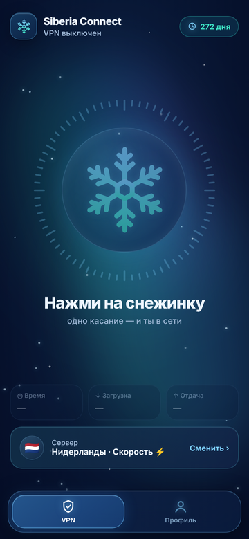
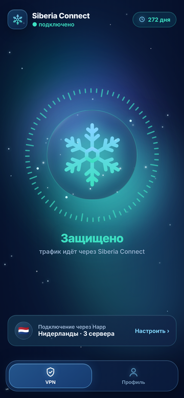

# Siberia Connect для Android

**Быстрый VPN без лимита трафика. Одно касание — и ты в сети ❄️**

[**⬇️ Скачать приложение**](https://sibirapp.duckdns.org/app/dl/) &nbsp;·&nbsp; [**🤖 Бот @SibirConnectBot**](https://t.me/SibirConnectBot)

 &nbsp; 

## Возможности

- ❄️ **Одна кнопка** — нажми на снежинку, и VPN включён. Без сторонних программ и ручных настроек
- ⚡ **Три способа подключения** — «Скорость», «Обход блокировок», «Звонки и игры»
- 🏦 **Приложения без VPN** — банки, Госуслуги и маркетплейсы работают напрямую
- 🇷🇺 **Российские сайты напрямую** — быстрее и без лишних проверок
- 🔄 **Включение при запуске телефона** и постоянный VPN
- 📲 **Вход через Telegram или по коду доступа** — можно и без Telegram
- 🔔 **Обновления прямо в приложении**

## Как начать

1. Скачай приложение на [странице загрузки](https://sibirapp.duckdns.org/app/dl/) и установи его
2. Войди через Telegram или по коду доступа
3. Возьми пробный период или тариф — и нажми на снежинку

## Доступ и поддержка

Приложение работает только с личным ключом Siberia Connect. Подписка, пробный период и поддержка — в боте [@SibirConnectBot](https://t.me/SibirConnectBot).

---

Siberia Connect для Android основан на открытом проекте [v2rayNG](https://github.com/2dust/v2rayNG) (© 2dust и участники) и распространяется на условиях лицензии [GPL-3.0](LICENSE). Исходный код всех изменений Siberia Connect открыт в этом репозитории.
